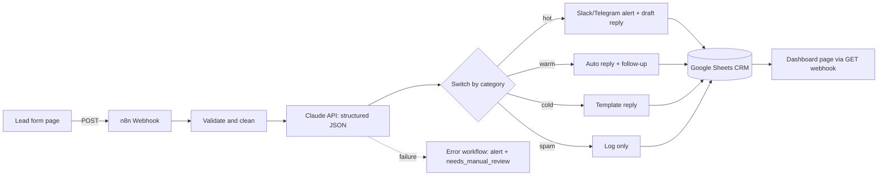

# Architecture

n8n is the backend. The React app only submits a lead and reads the dashboard. There is no custom server in this repo.

## What each part does

| Piece | Role |
|---|---|
| `web/` | Lead form and dashboard. Plain React and CSS. |
| `workflows/01-lead-intake` | Validate, score, route, store. Not exported yet. |
| `workflows/02-followups` | Morning follow-up for warm leads. Not exported yet. |
| `workflows/03-dashboard-api` | `GET /leads` with an `x-api-key` header. Not exported yet. |
| `workflows/99-error-handler` | Alert on a failed execution. Not exported yet. |
| `prompts/` | System prompts copied into n8n. Empty until Day 8 and Day 12. |
| `schemas/lead-score.schema.json` | Shape the model must return. |
| Google Sheets tab `leads` | Mini CRM. |
| Claude Messages API | Score and, later, draft replies. Temperature 0 for scoring. |

## Lead fields

Form fields: `name`, `email`, `company`, `website`, `budget_range`, `message`, plus hidden `website_url_confirm` (honeypot).

Fields the workflow adds: `lead_id`, `created_at`, `intent`, `budget_estimate`, `urgency`, `score`, `category`, `summary`, `next_action`, `reply_status`, `status`, `error_note`.

Sheet columns, in order: `lead_id`, `created_at`, `name`, `email`, `company`, `website`, `budget_range`, `message`, `intent`, `budget_estimate`, `urgency`, `score`, `category`, `summary`, `next_action`, `reply_status`, `status`, `error_note`.

## Status values

| Category or failure | `status` |
|---|---|
| hot | `alerted` |
| warm | `auto_replied`, then `followed_up` after the one follow-up |
| cold | `logged` |
| spam | `dropped` |
| model, email, or other failure | `needs_manual_review` |

## Rules that keep a lead

1. Validate the form before any Claude call. A bad form gets HTTP 400 and is not scored.
2. A filled honeypot is spam and does not call Claude.
3. Check every enum and required field on the tool result before the Switch node.
4. Retry the Claude and Gmail nodes. If they still fail, write the row with `needs_manual_review` and alert.
5. Hot replies are drafts. Warm and cold are the only automatic emails, and only after the category is one of those two enums.
